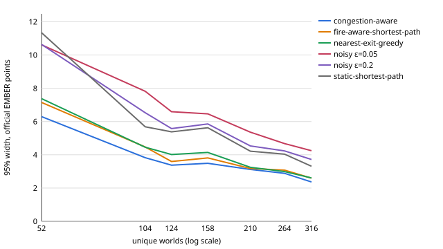

# Unseen evaluation suite: scientific design (research, V1)

| Field | Value |
| --- | --- |
| Status | **Research proposal. Not merged.** Waits for the scoring contract (PR #32). |
| Scope | Design of the official V1 unseen (hidden) evaluation suite. No simulator, scenario, generator or metric change. |
| Companion documents | [difficulty-calibration.md](difficulty-calibration.md), [suite-design-results.md](suite-design-results.md) |
| Analysis tool | [`tools/analyze_suite_design.py`](../tools/analyze_suite_design.py) (`audit-public`, `study`) |
| Tests | [`tests/test_suite_design.py`](../tests/test_suite_design.py) |
| Score used here | The **provisional** safety-only analysis score (section 11). It is not the EMBER Score. |

This document is named "evaluation suite", not "held-out suite", on purpose:
the leak guard (`emberbench.leakguard`) rejects any repository path with a
`heldout-` component, so that private material cannot be committed by
accident. The document holds no private scenario, seed or result.

## 0. Summary of the recommendation

- **Size:** 12 families x 20 scenarios = **240 scenarios, 384 unique
  worlds** (168 deterministic scenarios with 1 world, 72 stochastic scenarios
  with 3 distinct fire worlds). Minimum acceptable: 12 per family.
- **Difficulty per family:** Easy 2, Moderate 4, Hard 8, Stress 6, from the
  measured oracle gap of a fixed public reference panel. No hand labels.
- **Model trials:** K = 1 for verified-deterministic models, K = 3 otherwise.
  Trials are never counted as worlds.
- **Precision (provisional score):** mean 95% interval width about 8 points
  for one model's overall score; adjacent public baselines 5 points apart are
  ranked correctly in every draw; a 0.4-point gap is a tie at any size.
- **World identity:** a seed-free fire-trajectory digest. Equal fire
  trajectories are one world; a deterministic scenario is one world.
- **Findings for other work:** PR #32's `fire_world_digest` includes the seed;
  the manifest builder schedules duplicate deterministic episodes; the
  generator names only 3 primary families; the public suite is 73 unique
  worlds for 640 nominal episodes and has one scenario per family.
- **Protocol:** frozen rules, private seeds and selection key with public
  commitments, measured selection, one frozen pack per suite, new suite per
  round, never a silent replacement.

## 1. Literature review

The table lists the primary sources and what each one implies for EMBERBench.

| Source | Finding | Implication for EMBERBench |
| --- | --- | --- |
| Cobbe, Hesse, Hilton, Schulman. *Leveraging Procedural Generation to Benchmark RL* (Procgen), ICML 2020, arXiv:1912.01588 | 16 procedurally generated environments. Generalization protocol: train on a finite level set (200 levels in easy mode, 500 in hard mode), test on the full level distribution. Agents need "as many as 10,000 levels" to close the generalization gap. Scores are normalized per environment by `R_min` and `R_max`. Results use 3 to 4 seeds. | A fixed public suite of 10 scenarios is memorizable. Scored evaluation must draw from an unbounded procedural distribution that no model saw. Per-world normalization by a privileged reference (EMBER's `M*`, `D*`) is the analogue of `R_max`. |
| Cobbe, Klimov, Hesse, Kim, Schulman. *Quantifying Generalization in RL* (CoinRun), ICML 2019, arXiv:1812.02341 | Agents overfit to surprisingly large training-level sets. | The number of distinct worlds, not the number of episodes, is the unit of evidence. |
| Machado, Bellemare, Talvitie, Veness, Hausknecht, Bowling. *Revisiting the Arcade Learning Environment*, JAIR 2018, arXiv:1709.06009 | A deterministic environment lets an agent memorize an open-loop action sequence ("the Brute"). Sticky actions (p = 0.25) add stochasticity; the Brute collapses under them (Asterix 6,909 to 308). Separate the games used to tune from the games used to report. 5 trials can lack power. | Deterministic worlds are memorizable when public. Stochastic fire is EMBER's robustness test. Repeating a deterministic world with a deterministic policy adds no evidence. Calibration and reporting must use different worlds. |
| Agarwal, Schwarzer, Castro, Courville, Bellemare. *Deep RL at the Edge of the Statistical Precipice*, NeurIPS 2021, arXiv:2108.13264 | With 3 to 5 runs per task, point estimates mislead; 3-run bootstrap intervals under-cover. Use a stratified bootstrap (resample runs inside each task), interval estimates, robust aggregates (IQM) and the probability of improvement. | Stratify by family. A stratum with one unit has no variance estimate (PR #32 notes a zero-width interval). Every family needs several independent scenarios. Report the probability of improvement next to the interval. |
| Henderson, Islam, Bachman, Pineau, Precup, Meger. *Deep RL that Matters*, AAAI 2018, arXiv:1709.06560 | Two groups of 5 seeds of the same algorithm can differ significantly. | Seeds are a source of variance to control and freeze, not a free sample-size multiplier. |
| Colas, Sigaud, Oudeyer. *How Many Random Seeds?*, 2018, arXiv:1806.08295 | Power analysis for RL comparisons. The bootstrap test has an inflated false-positive rate (about 10% at nominal 5%) with small samples; use at least 20 samples in pilot studies and more than the power analysis prescribes. | Size the suite from a power analysis, with margin, not from cost. |
| Bouthillier et al. *Accounting for Variance in Machine Learning Benchmarks*, MLSys 2021, arXiv:2103.03098 | Data sampling is the largest variance source; randomize as many sources as possible; a criterion P(A > B) >= 0.75 separates real improvements from benchmark fluctuation. | In EMBER the analogue of data sampling is **which worlds are drawn**. Our study confirms that between-scenario variance dominates (section 11). |
| Miller. *Adding Error Bars to Evals*, 2024, arXiv:2411.00640 | CLT standard errors; **clustered** standard errors when questions are grouped (naive errors can be about 3x too narrow); resample each question K times to cut within-question variance to sigma^2/K; paired differences; a closed-form sample-size formula. | Seeds of one scenario are a cluster. K model trials on the same frozen world reduce model variance without new worlds. Paired comparison on one frozen pack. |
| Ray, Achiam, Amodei. *Benchmarking Safe Exploration in Deep RL* (Safety Gym), OpenAI 2019 | Layouts are randomized at the start of each episode to stop trajectory memorization. Difficulty levels 0, 1, 2 differ by the number of hazards. | Difficulty bands defined by measurable content. EMBER needs evidence that its proxies track difficulty; section 4 shows that they track it only weakly. |
| Ji et al. *Safety-Gymnasium*, NeurIPS 2023 Datasets and Benchmarks, arXiv:2310.12567 | Levels 0 to 2 add obstacles and agents; results over 3 seeds and 10 evaluation iterations. | Same lesson: levels are structural, results are repeated. |
| Mattson et al. *MLPerf Training Benchmark*, MLSys 2020, arXiv:1910.01500 | Run counts come from measured run-to-run variance: 5 runs for vision, 10 for the rest; drop the fastest and the slowest; target "90% of entries ... within 5%" (vision) or 10%. Rules are frozen per round. | Choose repetition counts (K, seeds) from measured variance. Freeze the rules and the suite per round and give the round an identity. |
| Reddi et al. *MLPerf Inference Benchmark*, ISCA 2020, arXiv:1911.02549 | Minimum query counts and run durations are set so that tail statistics have a stated statistical confidence. | A stated precision target (here: interval width) fixes the minimum size. |
| Liang et al. *Holistic Evaluation of Language Models* (HELM), TMLR 2023, arXiv:2211.09110; *HELM Lite* (CRFM, 2023) | 16 core scenarios x 7 metric categories; every model on the same scenarios; at most 1,000 instances per scenario; HELM Classic used 3 random seeds for in-context example choice. | One frozen environment set for all models. Model stochasticity is handled by repeated trials on the same instances, not by new instances. |
| Recht, Roelofs, Schmidt, Shankar. *Do ImageNet Classifiers Generalize to ImageNet?*, ICML 2019, arXiv:1902.10811 | A new test set from the same process drops accuracy by 11% to 14% on ImageNet (3% to 15% on CIFAR-10), but the model ranking is largely kept. | A refreshed suite changes absolute scores. Scores are comparable only inside one suite revision. |
| Blum, Hardt. *The Ladder*, ICML 2015, arXiv:1502.04585; Dwork et al. *The Reusable Holdout*, Science 2015 | Repeated adaptive queries to a holdout overfit it. | Limit scored submissions per suite revision; publish coarse results during an active round. |
| Roelofs et al. *A Meta-Analysis of Overfitting in Machine Learning*, NeurIPS 2019 | Kaggle private holdouts showed little adaptive overfitting. | A hidden suite with limited queries works in practice. |
| Kiela et al. *Dynabench*, NAACL 2021, arXiv:2104.14337; Ott et al. *Mapping Global Dynamics of Benchmark Creation and Saturation in AI*, Nature Communications 2022 | Static benchmarks saturate quickly. | Define saturation triggers and a refresh policy in advance. |
| Jacovi, Caciularu, Goldman, Goldberg. *Stop Uploading Test Data in Plain Text*, EMNLP 2023, arXiv:2305.10160 | Test data in public plain text contaminates later models. | Never publish a live pack. Publish digests only. |
| Zhang et al. *A Careful Examination of LLM Performance on Grade School Arithmetic* (GSM1k), 2024, arXiv:2405.00332 | Some models drop on a fresh, equivalent test set, which shows overfitting to the public one. | A fresh batch from the same generator config is the contamination check. |
| White et al. *LiveBench*, 2024, arXiv:2406.19314; Jain et al. *LiveCodeBench*, 2024, arXiv:2403.07974 | Dated, periodically refreshed releases limit contamination. | Each round gets a new batch identity; old rounds are retired, not edited. |
| Rodriguez et al. *Evaluation Examples Are Not Equally Informative*, ACL 2021; Polo et al. *tinyBenchmarks*, ICML 2024, arXiv:2402.14992 | Item response theory: items differ in difficulty and discrimination; 100 curated MMLU items can reproduce full-benchmark estimates. | Prefer worlds that separate methods. But EMBER episode scores are near-bimodal, so far fewer worlds are not enough (section 11). |
| Dennis et al. *PAIRED*, NeurIPS 2020, arXiv:2012.02096 | Environment difficulty as regret: the gap between a strong reference and the agent. | The oracle gap of the best fair baseline is a principled difficulty measure (difficulty-calibration.md). |
| Kirk, Zhang, Grefenstette, Rocktäschel. *A Survey of Zero-Shot Generalisation in Deep RL*, JAIR 2023, arXiv:2111.09794 | Train and test context sets must be disjoint and drawn by a stated process. | Development (public) and evaluation (private) contexts come from disjoint seed domains. |
| Card et al. *With Little Power Comes Great Responsibility*, EMNLP 2020, arXiv:2010.06595 | Many test sets are too small to detect the effects they report. | State the minimum detectable effect of the suite. |

## 2. Audit of the public V1 suite

Full tables: [suite-design-results.md, part A](suite-design-results.md#part-a-public-v1-suite-audit).
The public suite (hash `5274d103...065b`) has 10 scenarios, one per family
except `split_flow_across_exits`, which shares `v1-pub-09` with `crowd_100`.

| Property | Public suite |
| --- | --- |
| Grid sizes | 12x9 to 26x16 |
| Population `N` | 4, 36, 8, 5, 8, 6, 9, 5, 100, 6 (seven scenarios have `N <= 9`) |
| Exits | 4 single, 5 double, 1 triple |
| Ignitions | 1, except `v1-pub-07` (3) |
| Fire model | 9 deterministic, 1 stochastic (`v1-pub-10`) |
| `N / min vertex cut` | 2.5 to 36 |
| Static plan invalidated by fire | only `v1-pub-06` (0.5), `v1-pub-07` (0.11), `v1-pub-10` (median 0.83) |
| Final burn share | about 1 everywhere (the fire fills the map) |
| Provisional band | Easy: 01, 04. Moderate: 03, 08. Hard: 02, 10. Stress: 05, 06, 07, 09 |

Weaknesses for use as a scientific evaluation suite (it was designed as a
public development suite, and it is good for that):

1. **One scenario per family.** Every family-level confidence interval from a
   resampling bootstrap has zero width (there is nothing to resample), and a
   family score is one world. Family results are anecdotes.
2. **Few unique worlds.** A schedule of 64 seeds per scenario is 640 nominal
   episodes but only **73 unique worlds**: each deterministic scenario is one
   world for every seed (567 duplicates). Reported sample sizes that count
   seeds overstate the evidence by a factor of about 9.
3. **Small populations.** Seven of ten scenarios have 9 or fewer people, so
   one casualty moves a score by more than 10%. Crowd interaction is tested by
   two scenarios.
4. **Weak separation.** `nearest-exit`, `static` and `fire-aware` give the
   same score on 7 of 10 scenarios. Only 3 scenarios invalidate a static plan.
5. **Public.** Every scenario, hash and trajectory is in the repository. Any
   model can be tuned on it. It must never be the scored suite.

## 3. Unique worlds and world identity

In V1 the episode seed feeds only the fire stream (`FIRE_STREAM`), and the
observation never contains the seed. The agent's view of an episode is fully
determined by the scenario and the exogenous fire trajectory. So:

> **World** = (simulator version, observation version, scenario content hash,
> exogenous fire trajectory).

```text
fire_trajectory_digest = sha256(canonical_json({scenario_hash, burning cells per snapshot}))
world_id               = sha256(canonical_json({world_identity_version: "1.0", simulator_version,
                                                observation_version, scenario_hash,
                                                fire_trajectory_digest}))
```

- The seed is **not** an input of the digest. Two seeds with equal fire
  trajectories give one world. A deterministic scenario is always one world.
- The model is **not** an input. Tests check that every baseline sees exactly
  the precomputed `fire_trajectory(scenario, seed)`.
- The trajectory covers `max_steps + 1` snapshots, so two worlds that differ
  only after the episode ends are still counted as different. This is
  conservative (no under-counting of duplicates is possible inside the horizon)
  and costs nothing.
- **Finding for PR #32.** Its `fire_world_digest` hashes the seed together
  with the trajectory, so it cannot detect two seeds with equal trajectories
  (for example a stochastic scenario whose ignition is sealed by walls; see
  the `SEALED` test layout). Use a seed-free trajectory digest for duplicate
  detection and keep the seed only as an episode attribute.
- **Finding for the current manifest builder.** `build_evaluation_manifest`
  schedules the cross product of scenarios and seeds, so it repeats every
  deterministic scenario once per seed. The tool adds
  `build_unique_world_manifest`, which schedules one episode per deterministic
  scenario and `S` distinct-world seeds per stochastic scenario. The existing
  `EvaluationManifest` validator already accepts such ragged schedules.

## 4. Capability axes and families

The V1 families (`ScenarioFamily`) stay the primary strata. No new mechanic
(smoke, floors, psychology) is introduced. The axes group them:

| Capability axis | Primary families | Measured property that defines the tag |
| --- | --- | --- |
| Basic evacuation | `single_exit_low_density` | one exit, crowd density < 0.15 |
| Queueing and flow | `single_exit_high_density`, `narrow_corridor_bottleneck`, `crowd_100`, `split_flow_across_exits` | density >= 0.15; passage width 1 and `N / cut >= 4`; `N >= 100`; several exits, `N >= 20`, split pressure > 1 |
| Exit choice | `multiple_exits_unequal_distance`, `deceptive_nearest_exit` | exit-gap median >= 4; share of people whose nearest exit is a dead end or longer by route >= 0.25 |
| Hazard-aware routing | `central_ignition`, `threatened_nearest_exit`, `multiple_ignitions` | ignition centrality <= 0.34; mean threatened share >= 0.2 (privileged); >= 2 ignitions |
| Navigation | `maze_obstacle_routing` | obstacle density >= 0.25 or detour ratio >= 1.5 |
| Replanning | `route_invalidation_replanning` | mean recoverable invalidation share >= 0.2 (privileged) |
| Robustness to fire randomness | (orthogonal stratum, not a family) | `fire.model == stochastic` |

The generator's own `describe_families` can only name three primary families
(`single_exit_low_density`, `single_exit_high_density`,
`split_flow_across_exits`). So the evaluator assigns families with the
measured tags above (`family_tags` in the tool). A scenario can carry several
tags; it is selected for **one** primary family, which is the stratum used by
the PR #32 hierarchy (episode-trial, episode, scenario, primary family,
overall). Other tags are kept for diagnostics only.

## 5. Difficulty tiers

Full definition and evidence: [difficulty-calibration.md](difficulty-calibration.md).

- Band from the oracle gap of the fair reference panel with fixed cutpoints:
  Easy (worst >= 90), Moderate (best >= 90 > worst), Hard (30 <= best < 90),
  Stress (best < 30).
- Structural proxies do not predict difficulty (`|rho| <= 0.24`). Privileged
  fire-dynamics proxies do (about 0.6). Both are recorded; only the panel sets
  the band.
- 61% of raw generated worlds are solved by every panel member or failed by
  every panel member. Calibration is therefore necessary, not cosmetic.

## 6. Suite size alternatives

Assumptions: 12 families, the band mix of section 7, 30% stochastic scenarios
with `S = 3` distinct worlds, so 1.6 unique worlds per scenario on average.
Interval widths are the 95% bootstrap width of one agent's family-balanced
provisional score, from the subsampling study (section 11; maximum over the
five baselines, then mean). Calls assume one model call per step, the
measured mean of 20.6 steps for a competent policy and 82.8 for a policy that
stalls until `max_steps`.

| Option | Scenarios per family | Scenarios | Unique worlds | Episodes per model (K = 1 / 3) | 95% width, max / mean | Band mix 2/4/8/6 per family | Storage | Evaluator CPU per baseline | Calls per model at K = 3 (competent / upper bound) |
| --- | ---: | ---: | ---: | --- | --- | --- | ---: | ---: | --- |
| about 50 | 4 | 48 | 77 | 77 / 231 | 22.8 / 17.6 | no (4 of 20) | 0.2 MB | about 2 s | 4,800 / 19,100 |
| about 100 | 8 | 96 | 154 | 154 / 462 | 15.5 / 12.4 | no (8 of 20) | 0.4 MB | about 5 s | 9,500 / 38,300 |
| minimum | 12 | 144 | 230 | 230 / 690 | 12.4 / 9.5 | no (12 of 20) | 0.6 MB | about 7 s | 14,200 / 57,100 |
| about 200 | 16 | 192 | 307 | 307 / 921 | 11.6 / 9.0 | no (16 of 20) | 0.8 MB | about 9 s | 19,000 / 76,300 |
| **recommended** | **20** | **240** | **384** | **384 / 1,152** | **11.1 / 8.1** | **yes** | **1.0 MB** | **about 12 s** | **23,700 / 95,400** |
| about 400 | 32 | 384 | 614 | 614 / 1,842 | 8.0 / 6.3 | yes | 1.5 MB | about 18 s | 37,900 / 152,500 |

Storage uses the measured mean scenario file of 4.0 KB; evaluator CPU uses
the measured mean of 0.03 s per baseline episode. Widths are on the 0 to 100
score scale (a width of 8 is about +-4 points).

- **Fewer than 2 scenarios per family** gives no family-level interval at
  all.
- **About 50 scenarios** cannot hold the band mix (20 cells per family) and
  gives overall intervals of about +-9 points: enough to separate random from
  heuristic, not enough to compare competent models in absolute terms.
- **About 100 scenarios** already ranks public baselines 5 points apart
  correctly (pairing does that from 2 per family), but the overall interval
  is about +-6 points and each family has only 8 scenarios.
- **12 per family** is the minimum: about +-5 points overall and at least
  one scenario in most family x band cells.
- **240 scenarios** (recommended) fills every family x band cell, keeps
  the mean interval width near 8 points (worst baseline 11), and costs less than 2 MB of storage and
  under a minute of evaluator CPU per baseline.
- **Larger than about 400** gives little: the width falls only with the
  square root of the size, and a gap of 0.4 points (fire-aware vs
  congestion-aware) is not resolvable at any size in the table. Spend extra
  budget on refresh rounds, not on one larger suite.

The cost of API evaluation was not the criterion. It is reported so that
participants can plan.

## 7. Family and difficulty allocation

| | Easy | Moderate | Hard | Stress | Total |
| --- | ---: | ---: | ---: | ---: | ---: |
| Per family | 2 | 4 | 8 | 6 | 20 |
| Share | 10% | 20% | 40% | 30% | |
| Suite (12 families) | 24 | 48 | 96 | 72 | 240 |

- Every family gets the same number of scenarios. The PR #32 aggregation
  weights families equally, so equal allocation minimizes the variance of the
  overall score for a fixed size (each family term has weight 1/12).
- Hard carries the most weight because it is where the panel spreads most
  (section 5 of the calibration document). Easy is a control: a model that
  fails Easy worlds has a basic fault.
- Inside each family about 6 of the 20 scenarios are stochastic (spread over
  the bands as the candidates allow). Families whose current recipes give no
  stochastic candidates (`single_exit_high_density`, `crowd_100`,
  `split_flow_across_exits`) need stochastic variants of the existing
  generator configs. That is a config change, not a simulator change.
- **Feasibility on the development pool.** On the 400-scenario development pool (only 1.7 times the suite
  size), `select_suite` filled 184 of the 240 cells; 56 were short. Shortfall is
  concentrated where the pool is thin (`crowd_100`, `split_flow_across_exits`)
  or the family has no natural easy worlds (`route_invalidation_replanning`
  has 0 Easy and 0 Moderate among 30 tagged scenarios). The pre-registered
  shortfall rule (calibration document, section 7) handles this: oversample
  the family's recipe, then move the quota to the nearest band. The real
  candidate pool must be about 10 times the suite size (about 2,500
  candidates), with dedicated recipes for the rare families.
- Selection: `select_suite(candidates, quotas, selection_key)` fills the
  scarcest family first, in keyed-hash order, never uses one scenario twice
  and reports shortfall instead of filling silently.

## 8. Stochastic seed policy

- A stochastic scenario contributes `S = 3` **distinct** worlds. Seeds are
  drawn from the private episode seed stream in order, and a seed whose fire
  trajectory digest equals an earlier one is skipped
  (`select_distinct_seeds`). If a scenario cannot give 3 distinct worlds from
  64 candidate seeds, it is treated as deterministic (one world) and that is
  recorded.
- The scenario score is the mean over its distinct worlds. Worlds of one
  scenario are not independent samples of the suite; resampling is two-stage
  (scenarios, then worlds), as in PR #32.
- **Why 3.** The within-scenario (fire) variance is 0.18 to 0.53 of the
  between-scenario variance for the panel. The precision-optimal number of
  worlds per scenario is therefore below 1 (`S* = sqrt(ratio) < 0.73`): extra
  scenarios buy more precision than extra seeds. Seeds still matter for
  validity: one seed measures one fire draw, not the scenario's fire
  distribution. Three distinct worlds give a per-scenario variance estimate
  with 2 degrees of freedom and cut the fire term of the variance by 3. In the sample-size study, changing from 4 to 3 worlds per stochastic
  scenario changed the mean width at 32 scenarios per family from 6.30 to
  6.29: seeds beyond 3 buy almost no precision.
- Seeds are never published before the suite retires, never chosen per model
  and never re-drawn after any model runs.

## 9. Deterministic scenario policy

- A deterministic scenario is **one world**. It gets exactly one scheduled
  episode per trial, whatever the seed list.
- Reports count unique worlds, not seed x scenario pairs. A manifest that
  repeats a world (equal `world_id`) is rejected by the freeze step.
- Deterministic scenarios are not weaker evidence: the fire is fixed, so all
  information is in the agent's behavior. They make up 70% of the suite
  because scenario diversity, not fire diversity, dominates the variance.

## 10. Model trials (K)

Trials repeat a world for one model; they are **not** new worlds and add no
new environments. The world seed stays fixed; only the model's own sampling
changes.

| Model | K | Reason |
| --- | ---: | --- |
| Deterministic code or a model verified deterministic (identical action sequences in 2 trials on a 10% sample of worlds) | 1 | Repeats give identical episodes. |
| Non-deterministic model (sampling, non-deterministic API) | 3 | See below. |
| Non-deterministic, pilot within/between trial-variance ratio > 0.5 | 5 | |

Evidence: an epsilon-noisy surrogate (congestion-aware with 10% random
actions, 8 trials on 40 worlds) has a within-world trial variance of 0.385 of
the between-world variance. The CI width inflation against infinite trials
is 1.18 for K = 1, 1.09 for K = 2, 1.06 for K = 3, 1.04 for K = 5. K = 3
captures most of the gain and gives a per-world trial-variance estimate, which
is required to report reliability (Miller 2024; Bouthillier et al. 2021). The
model's per-world mean over trials is the episode value (PR #32
episode-trial level). Trial seeds or sampling settings are recorded with the
submission.

## 11. Sample size and interval width

Score used: the **provisional analysis score** is the PR #32 safety factor
only (`100 x E x P_casualty x P_stranding`, with the catastrophic gate),
computed against `M*`. It omits the quality factor. It is used only to study
variance and ranking stability, and every number in this section must be
recomputed with the final EMBER Score.

Method: from the development pool (11 families with at least 3 scenarios),
draw `m` scenarios per family without replacement (400 draws per size), use
`S = 3` worlds per stochastic scenario, compute each baseline's
family-balanced score, and measure (a) the 2.5 to 97.5 percentile width over
draws and (b) the probability that a pair of adjacent baselines is ranked in
the wrong order.

| Scenarios per family | Scenarios | Unique worlds | Max 95% width | Mean 95% width | Mean CLT width | P(rev) static / fire-aware (gap 4.9) | P(rev) fire-aware / congestion (gap 0.4) | P(exact ranking of 5) |
| ---: | ---: | ---: | ---: | ---: | ---: | ---: | ---: | ---: |
| 1 | 11 | 16 | 47.37 | 36.48 | 0.00 | 0.11 | 0.42 | 0.63 |
| 2 | 22 | 33 | 32.33 | 25.63 | 24.55 | 0.01 | 0.44 | 0.56 |
| 4 | 44 | 65 | 22.77 | 17.60 | 17.70 | 0.00 | 0.44 | 0.56 |
| 8 | 88 | 131 | 15.48 | 12.42 | 12.59 | 0.00 | 0.37 | 0.63 |
| 12 | 132 | 196 | 12.36 | 9.46 | 10.35 | 0.00 | 0.35 | 0.65 |
| 16 | 176 | 261 | 11.59 | 8.96 | 8.95 | 0.00 | 0.34 | 0.67 |
| **20** | **220** | **326** | **11.11** | **8.07** | **8.04** | **0.00** | **0.25** | **0.75** |
| 24 | 264 | 392 | 9.41 | 7.37 | 7.34 | 0.00 | 0.27 | 0.73 |
| 32 | 352 | 522 | 7.97 | 6.29 | 6.38 | 0.00 | 0.26 | 0.74 |

The adjacent pairs random / nearest-exit (gap 35.7) and nearest-exit / static
(gap 22.8) are never reversed at any size. The study pool has a stochastic
share of 0.24, so it has slightly fewer worlds per scenario than the proposal
(0.30). Pool family-balanced scores: random 0.36, nearest-exit 36.11, static
58.88, fire-aware 63.75, congestion-aware 64.16.



Findings:

- The width falls about as `1 / sqrt(m)`. The stratified CLT width agrees
  with the subsampling width from `m = 2` on. With one scenario per family
  the CLT gives width 0 (no within-family variance can be estimated), which
  is the PR #32 zero-width case.
- **Ranking needs pairing, not size.** Static vs fire-aware differ by 4.9
  points overall, but they are almost never reversed from `m = 2` on, because
  both are evaluated on the same worlds and the per-world differences are
  consistent. Fire-aware vs congestion-aware differ by 0.4 points and are
  reversed in 26% to 45% of draws at every size: they are tied, and the
  report must say so instead of ranking them.
- Reports should therefore give paired-difference intervals between models
  (same worlds, same trials), not only per-model intervals.

## 12. Generation and freeze protocol

1. **Freeze the rules.** Simulator, observation, generator and scoring
   versions; recipes; tag thresholds; reference panel and band cutpoints;
   quotas and shortfall rule. Publish a hash of this rule set before any
   private material exists.
2. **Freeze submissions** (`freeze_submission`), or use post-submission
   generation (integrity section 8), so that no model can be tuned on the
   suite and the suite cannot be tuned on any model.
3. **Draw private material** from a CSPRNG in the evaluator's private
   workspace: one generator seed per recipe, one episode seed stream, one
   selection key. Publish SHA-256 commitments only.
4. **Generate the candidate pool** (`generate_suite(config, seed,
   batch_id=...)` per recipe), about 10 times the suite size. Remove duplicate
   scenario hashes and any scenario equal to a public or earlier-round
   scenario.
5. **Measure every candidate** evaluator-side: structural profile, distinct
   worlds (`select_distinct_seeds`), world IDs, privileged profile, panel
   scores, band, family tags. Exclude scenarios with no escapable person and
   Stress candidates whose `M*` exceeds the exit-throughput cap.
6. **Select** with `select_suite` and the private key. Apply the shortfall
   rule and check the discrimination floor. Nothing about any submitted model
   is an input.
7. **Write the selected scenarios as a plain suite** and schedule it with
   `build_unique_world_manifest`. Verify that every `world_id` is unique.
8. **Freeze one environment pack** (PR #32 `freeze_environment_pack`) with a
   new suite ID, batch ID and version. Publish: suite hash, manifest hash,
   pack hash, counts per family x band x fire model, rule-set hash. Keep the
   seeds, key and measurements in the private freeze record.
9. **Evaluate and audit.** Every model runs the same pack (no model-specific
   regeneration) with its K. Results are replay-verified. At retirement,
   reveal the generator seeds, key and pack so that anybody can check the
   suite with `verify_regeneration`.

## 13. Leakage and contamination controls

- **No hidden information to developers.** Developers receive the public
  suite, the generator, the rules and the commitments. They never receive
  scenario files, seeds, world IDs, per-world results or bands of the hidden
  suite before it retires. The observation format contains no seed.
- **Repository guard.** Private material lives only under paths the leak
  guard forbids (`hidden/`, `private/`, `heldout-*`, ...). Tests check that
  the research files of this proposal pass the guard and that the tool
  contains no seed literal (every development seed is derived from a public
  label).
- **Per-world results stay private.** Published results are per family and
  overall. A per-world table would reveal the hidden worlds' difficulty
  structure.
- **API exposure.** A model behind an API sees the hidden worlds in its
  prompts, and the provider may keep them. Use zero-retention terms where
  available, record which providers saw which suite, and treat a suite as
  exposed to a provider after its round.
- **Contamination test.** Before a round closes, generate a small fresh
  shadow suite with the same rules and a new key (as GSM1k did for GSM8k).
  A model whose score on the hidden suite exceeds its score on the shadow
  suite by more than the paired interval is flagged.
- **Canary.** The evaluation harness puts a fixed canary string in every
  hidden-suite prompt and pack archive (not in the scenario format, which
  stays unchanged), so that copies in crawled data can be found later.

## 14. Refresh policy

A suite is replaced, never edited. Every replacement gets a **new suite ID,
batch ID and version** and a public changelog; scores on different suites are
not pooled and not ranked against each other.

| Trigger | Action |
| --- | --- |
| Scheduled | New suite every evaluation round (recommended at least every 6 months). Retire and reveal the previous one. |
| Leak or exposure | Retire immediately. Re-run all affected models on a new suite. |
| Saturation | If the best model scores >= 90 on the Hard band or on the overall score, re-calibrate the bands (stronger reference panel) under a new rule version. |
| Simulator, observation or generator revision | New suite, because world IDs change. |
| Defect in a world (for example a wrong `M*`) | Retire the suite, publish the defect, regenerate. Do not drop worlds from a live suite. |

To compare rounds, run the public reference panel on every suite and report
each model relative to the panel (a linking set), not raw scores across
suites.

## 15. API workload

Per model, for the recommended suite (384 unique worlds):

| K | episodes | calls (competent, mean 20.6 steps) | calls (upper bound, mean max_steps 82.8) | input characters per call (step 0, median / max) |
| ---: | ---: | ---: | ---: | --- |
| 1 | 384 | about 7,900 | about 31,800 | 1,406 / 7,114 |
| 3 | 1,152 | about 23,700 | about 95,400 | 1,406 / 7,114 |
| 5 | 1,920 | about 39,600 | about 159,000 | 1,406 / 7,114 |

At about 4 characters per token, a typical observation is about 350 tokens
(maximum about 1,800), before the system prompt and any history the harness
sends. The evaluator side is small: a median of 0.03 s per baseline episode
and about 4 KB per scenario file.

## 16. Open issues for PR #32 and the code

1. `fire_world_digest` must not include the seed when it is used to detect
   duplicate worlds (section 3).
2. The manifest builder schedules a cross product. Add a unique-world mode or
   use `build_unique_world_manifest` (section 3).
3. A one-scenario-per-family suite gives zero-width intervals; the report must
   say "not estimable", not "0".
4. `describe_families` names only 3 primary families. Either extend it with
   the measured tags of section 4 (generator change, new generator version) or
   keep family assignment evaluator-side as proposed here.
5. `M*` relaxes congestion. A joint bound (max-flow over time) would make
   Stress bands more meaningful. No simulator change is needed.

## 17. Final proposal

| Item | Proposal |
| --- | --- |
| Families | The 12 V1 families as primary strata (section 4); stochastic fire is an orthogonal stratum |
| Scenarios per family | 20 |
| Difficulty per family | Easy 2, Moderate 4, Hard 8, Stress 6 (10/20/40/30%), from the panel-gap bands with frozen cutpoints |
| Deterministic scenarios | 14 per family, 168 in total, 1 world each |
| Stochastic scenarios | 6 per family, 72 in total |
| Distinct worlds per stochastic scenario | `S = 3` (216 worlds) |
| Total unique worlds | **384** (240 scenarios) |
| Model trials | K = 1 for verified-deterministic models; K = 3 otherwise; K = 5 if the pilot trial-variance ratio is above 0.5 |
| Episodes per model | 384 (K = 1), 1,152 (K = 3), 1,920 (K = 5) |
| Minimum acceptable size | 12 scenarios per family (144 scenarios, about 230 worlds); below that, no family x band coverage and a mean width above 9.5 |
| Expected 95% interval width | about 8 points mean, about 11 points worst case, for one model's overall provisional score (half-width about +-4 to +-5.5); paired differences between models are much narrower |
| Candidate pool | about 10 times the suite (about 2,500 candidates), with dedicated recipes for `crowd_100`, `split_flow_across_exits` and `route_invalidation_replanning` |
| Protocol | Section 12 (rules frozen and committed, private seeds and key, measured selection, unique-world manifest, one frozen pack, replay-verified evaluation, reveal at retirement) |
| Refresh | Section 14 (new suite per round, at least every 6 months; immediate refresh on leak, revision or defect; never a silent replacement) |

All numbers that depend on the score must be recomputed with the final EMBER
Score after PR #32 merges. The structural numbers (unique worlds, families,
feasibility) do not depend on the score.
